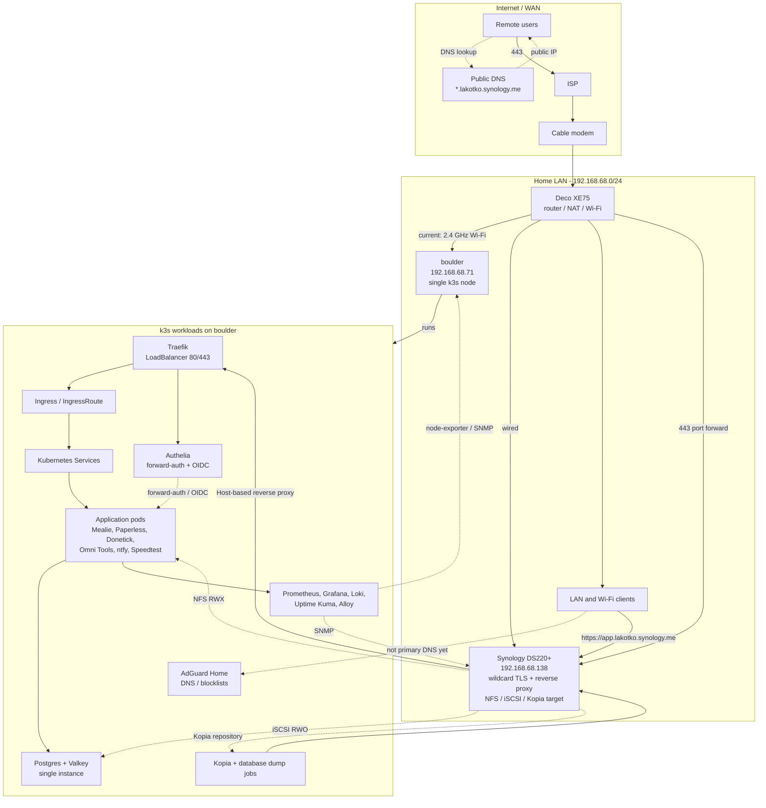
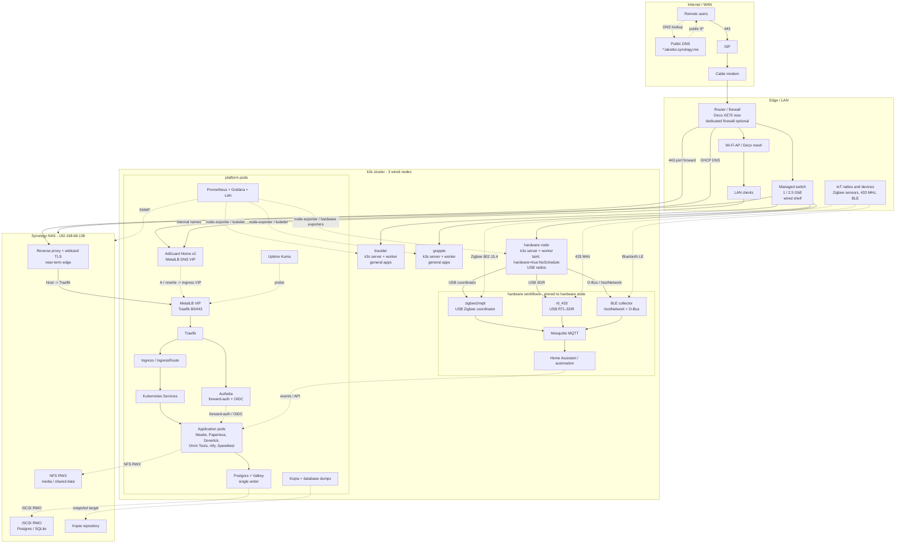
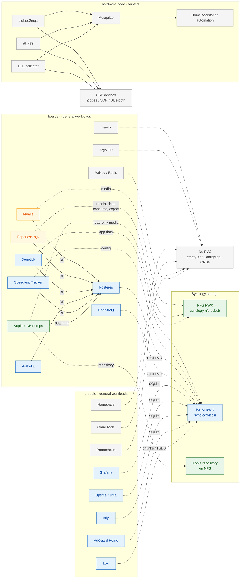

# Architecture

This file holds the current and proposed homelab architecture diagrams. Update
the Mermaid blocks here when the network, cluster, ingress, storage, or hardware
node changes.

Solid lines are traffic paths. Dashed lines are DNS, storage, radio, or
observability relationships.

## Current architecture

Everything runs on one k3s node (`boulder`), which is currently reached over
2.4 GHz Wi-Fi. Synology is the public TLS/reverse-proxy edge and the
storage/backup target.



## Proposed multi-node architecture

The main changes are:

- Wire the modem, router, switch, nodes, and Synology together.
- Run k3s across three wired nodes: `boulder`, `grapple`, and a dedicated
  hardware node.
- Use MetalLB VIPs for ingress and AdGuard DNS instead of pointing at one node
  IP.
- Keep Synology as the near-term edge proxy, TLS terminator, storage provider,
  and backup target.
- Taint the hardware node and pin USB-radio workloads to it.



The aggregated `WEBAPPS` and `DATA` boxes are expanded per application in the
storage map below.

## Application placement and storage

Each application is its own node below. The `boulder`, `grapple`, and
`hardware` groups are an example placement, not one VM per application. Move an
application between `boulder` and `grapple` as the scheduling model changes; the
storage edges show what the application actually mounts.

Color key:

- **Amber**: uses both NFS and iSCSI (directly, or through Postgres).
- **Green**: NFS only.
- **Blue**: iSCSI only.
- **Gray**: no persistent volume.



Applications marked **via Postgres** do not mount the iSCSI volume themselves;
their database rows live in Postgres' iSCSI-backed PVC. Mealie and Paperless are
the only applications that use both storage classes directly or indirectly:
NFS for document/media files and Postgres for relational data.

| Application | NFS | iSCSI | Storage note |
| --- | --- | --- | --- |
| Mealie | `mealie-media` | via Postgres | **Both** |
| Paperless-ngx | `paperless-media`, `-data`, `-consume`, `-export` | via Postgres | **Both** |
| Donetick | — | `donetick-data` + via Postgres | iSCSI only |
| Authelia | — | via Postgres | iSCSI only; legacy SQLite PVC retained but not mounted |
| Speedtest Tracker | — | `speedtest-tracker-config-v2` + via Postgres | iSCSI only; old corrupt PVC retained |
| Grafana | — | `grafana` SQLite | iSCSI only |
| Uptime Kuma | — | `uptime-kuma-config` SQLite | iSCSI only |
| ntfy | — | `ntfy-data-iscsi` SQLite | iSCSI only |
| AdGuard Home | — | `adguard-home-pvc` SQLite | iSCSI only |
| Loki | — | `storage-loki-0` chunks / TSDB | iSCSI only |
| RabbitMQ | — | 20Gi PVC | iSCSI only |
| Postgres | — | 10Gi PVC | iSCSI only |
| Prometheus | — | — | `emptyDir`; metrics are lost on restart |
| Homepage | — | — | ConfigMap only |
| Omni Tools | — | — | stateless |
| Traefik | — | — | no PVC |
| Argo CD | — | — | CRDs; Redis is ephemeral |
| Backup | repository + read-only media | pg_dump over the network | NFS only for mounted volumes |
| Hardware workflows | — | — | USB devices; no PVC defined yet |

## Request path

Public traffic:

```text
Remote user
  -> public DNS (*.lakotko.synology.me)
  -> ISP / modem / router
  -> Synology wildcard TLS + reverse proxy
  -> MetalLB ingress VIP
  -> Traefik
  -> Ingress / IngressRoute
  -> Kubernetes Service
  -> application pod
```

Internal traffic:

```text
LAN client
  -> AdGuard DNS VIP
  -> MetalLB ingress VIP
  -> Traefik
  -> Ingress / IngressRoute
  -> Kubernetes Service
  -> application pod
```

## Hardware-node responsibility

The hardware node should be the only place these pods run:

| Workflow | Device / dependency | Scheduling |
| --- | --- | --- |
| `zigbee2mqtt` | USB Zigbee coordinator, e.g. `/dev/ttyACM0` | `nodeSelector: hardware=true`, toleration, hostPath/device mount |
| `rtl_433` | USB RTL-SDR, `/dev/bus/usb` | Same node pinning; privileged or USB device access |
| BLE collector | Bluetooth adapter, D-Bus | `hostNetwork: true`, `/var/run/dbus` mount, node pinning |
| Mosquitto / automation | Local MQTT and automation state | Prefer the hardware node for radio locality |
| Home Assistant | MQTT broker, radio integrations | Hardware node, or general node with MQTT reachability |

General applications, Postgres, Valkey, and observability stay on
`boulder`/`grapple`. The hardware node gets a taint such as
`hardware=true:NoSchedule`, and only the radio workloads get the matching
toleration. That prevents a general pod from competing for USB devices or being
disrupted when the radio node reboots.

## Caveats

- This is **multi-node, not fully HA**. Three k3s servers give etcd quorum, but
  Postgres, Valkey, Synology, and the ISP connection remain single points of
  failure.
- True HA later needs Postgres replication or an operator, Redis/Valkey HA, a
  second NAS or offsite copy, and possibly dual WAN.
- Keep Synology as the edge proxy initially because the wildcard certificate and
  reverse-proxy rules already work. Moving edge/TLS fully into Traefik with
  MetalLB and cert-manager is a separate project.
- Use dedicated MetalLB VIPs: one for ingress, one for AdGuard DNS. Do not hand
  out a node IP through DHCP.
- If the hardware node is small, make it a k3s **agent** and add a separate small
  control-plane node; do not force etcd onto a device that may reboot for USB
  maintenance.
